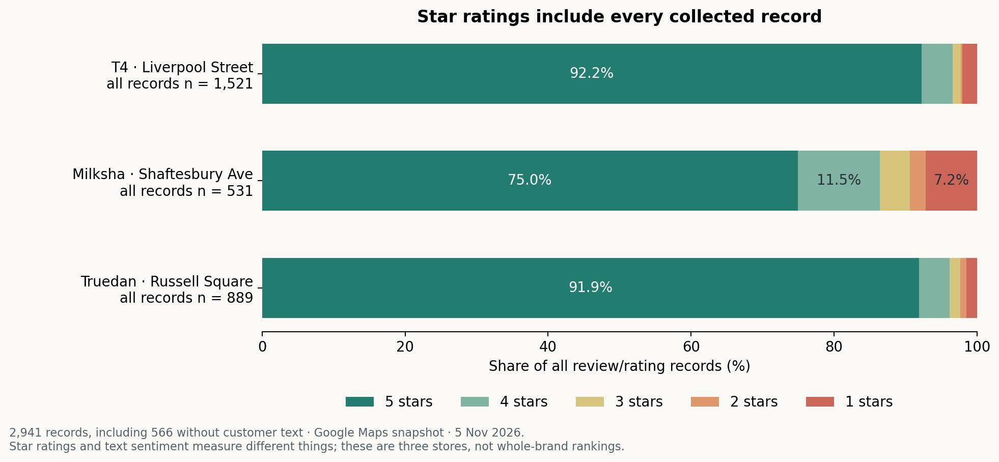
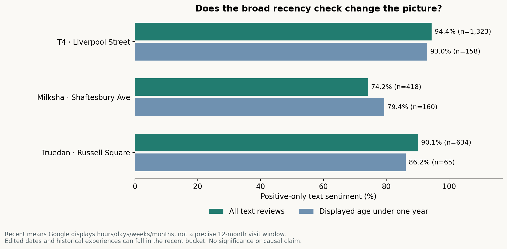

# Positioning a Taiwanese Bubble Tea Brand in Central London

*Authenticity, product experience and service in a competitive Zone 1 market — evidence from 2,941 Google review records across three Taiwanese-origin brands.*

## The business question

For a prospective Taiwanese bubble tea venture, what should distinguish the offer: authentic product experience, friendly service, reliable speed, or a combination?

The original brief proposed an authenticity-led venture, then considered an efficiency-first pivot. This expanded analysis examines **every review/rating record displayed for the three selected stores at collection**, replacing the earlier 53-text-review pilot. The evidence supports testing service improvements while protecting product appeal; it does not establish that speed should replace authenticity.

## Complete coverage of the selected stores

| Google Maps snapshot · 5 November 2026 | T4 · Liverpool Street | Milksha · Shaftesbury Ave | Truedan · Russell Square | Total |
|---|---:|---:|---:|---:|
| Listing total | 1,521 | 531 | 889 | **2,941** |
| Unique records collected | 1,521 | 531 | 889 | **2,941** |
| Text reviews analysed | 1,323 | 418 | 634 | **2,375** |
| Rating-only records | 198 | 113 | 255 | **566** |

Counts and per-star distributions reconcile with the listing snapshot. “Complete” refers to these three store listings on this date; it does not mean every branch, every platform, deleted reviews, or every customer's experience. Historical reviews are included. All 566 rating-only entries remain in the dataset and star-rating chart.

## 1 · Sentiment beyond star ratings

| Text sentiment | T4 | Milksha | Truedan |
|---|---:|---:|---:|
| Positive | 1,249 (94.4%) | 310 (74.2%) | 571 (90.1%) |
| Mixed | 35 (2.6%) | 59 (14.1%) | 28 (4.4%) |
| Neutral | 8 (0.6%) | 5 (1.2%) | 13 (2.1%) |
| Negative | 30 (2.3%) | 44 (10.5%) | 20 (3.2%) |
| Unclear | 1 (0.1%) | 0 (0.0%) | 2 (0.3%) |

AI semantic coding retains explicit praise and criticism in the same review as **mixed**. It does not convert five stars into a positive label. Across the stores, 76 five-star text reviews received another label. These are descriptive store-level results, not representative brand satisfaction scores or a league table.

## 2 · What customers talk about

Themes use a published dictionary across all 2,375 texts. Each review can mention several topics. This measures vocabulary presence, not the importance or sentiment of an individual attribute.

- **T4:** staff/service language appears in 842 reviews (63.6%), compared with speed/waiting in 128 (9.7%). The evidence is broader than a speed-only positioning story.
- **Milksha:** dessert/bakery language appears in 142 reviews (34.0%). Its customer experience extends beyond bubble tea, so product comparisons must account for this different offer.
- **Truedan:** authenticity/Taiwanese-origin language appears in 93 reviews (14.7%), versus 51 (12.2%) for Milksha and 17 (1.3%) for T4. This is a difference in expressed language, not proof of authenticity or willingness to pay.

Product/drink vocabulary is broad and can overlap with dessert comments. Staff names alone are not dictionary matches. [Definitions, dictionary and limitations](codebook.md).

## 3 · Every rating is included

Ratings provide a second description of the same Google records, not independent triangulation. Review volume is not sales, footfall, market share or repeat purchase.

## 4 · A check against historical weighting

Positive-only shares in the broadly recent text subset are 93.0% for T4 (n=158), 79.4% for Milksha (n=160) and 86.2% for Truedan (n=65). The pattern is not identical to the full history. Google displays relative publication/edit ages, so this is a sensitivity check, not a precise last-12-month visit study.

## What this means for the venture

**Protect product distinctiveness; test service reliability.** Reviews describe authenticity, flavour, toppings and staff experience alongside operational friction. Three illustrative cases show why a simple “speed beats craft” conclusion overreaches:

| Evidence example | Interpretation | Proposed response |
|---|---|---|
| T4-0269: praises drinks and staff, but reports an in-store wait alongside delivery-order pressure | Channels may compete for capacity | Record delivery load during peak-hour service tests |
| MILKSHA-0041: praises pearls and a later explanation, but criticises taro texture and initial complaint handling | Product consistency and recovery both matter | Track remakes and complaint resolution alongside timing |
| TRUEDAN-0108: praises tea, but reports a 27-minute wait and intent to leave if queues recur | Delay can threaten retention despite product appeal | Measure end-to-end median/p90 wait, not preparation time alone |

These are paraphrased, unverified customer accounts. They illustrate mechanisms rather than estimate their prevalence. [Evidence audit](evidence_audit.md) · [90-day proceed/change/stop test](90_day_test_plan.md).

## Why these brands and locations?

The original idea considered a wider competitive set, then focused on Taiwanese-origin brands to explore contrasting brand identities and expansion models. The selection rationale distinguishes domestic Taiwanese familiarity from international franchise reach. Current Taiwan footprints and franchise counts have not been independently verified and are not used as explanatory variables.

| Store | Address | Location context |
|---|---|---|
| T4 Liverpool Street | 8 Brushfield Street, London E1 6AN | Near Liverpool Street / Spitalfields; not inside the station |
| Milksha | 65 Shaftesbury Avenue, London W1D 6LH | Chinatown / Soho |
| Truedan Russell Square | Unit K1 Brunswick Square, London WC1N 1AW | Brunswick Centre |

**This is a central-London case comparison, not a controlled comparison on one street.** The initial ambition to study one competitive neighbourhood is not fulfilled by these locations. One store per brand confounds brand with location, customer mix, menu and time. No claim that these stores define London's “largest” competitive district is made.

## Method and transparency

1. Load the complete unfiltered Google Maps review lists in the default **Most relevant** order; expand available long customer texts and collect until unique IDs equal each listing total.
2. Retain all dates and ratings. Separate customer text from owner replies; keep rating-only entries for rating analysis.
3. Read every non-empty customer text with Codex and assign semantic sentiment. Apply a reproducible multi-label dictionary for topic mentions. These are different methods.
4. Reconcile IDs, record counts, star distributions and labels; aggregate and render charts from the public coding table.

Google-displayed translations may affect wording. **All sentiment labels are AI-assigned and await independent human validation.** No accuracy score is claimed. AI review is not a substitute for a human audit.

## Explore the evidence

- [Complete public coding table — all 2,941 records](review_coding_public.csv)
- [Collection and coverage checks](collection.md) · [Machine-readable checks](collection_checks.json)
- [Codebook](codebook.md) · [Theme dictionary](theme_dictionary.json) · [AI workflow](ai_workflow.md)
- [Detailed results and sensitivity analysis](findings.md) · [Computed totals](summary_counts.json)
- [Examples and evidence audit](evidence_audit.md) · [Source register](source_register.md)
- [90-day decision plan](90_day_test_plan.md) · [Blank human-validation worklist](author_review.csv)
- [Chart reproduction script](build_charts.py) · [Theme coding script](code_themes.py)

Run `python3 build_charts.py` with matplotlib and numpy installed to reproduce the five charts from the published labels. The script does not run a sentiment model. Reviewer names, profiles and full review text are not republished; source IDs, listing links, classifications and selected paraphrases are provided. Rechecking original wording requires access to the live source, which may change.

## Contribution and limits

The original individual project supplied the venture framing, case selection and strategic argument. Codex assisted with the expanded collection, full-text sentiment reading, dictionary design, aggregation, charts and documentation. Python code was generated with AI assistance; this portfolio does not claim an independently trained sentiment model or unaided Python development.

Full listing coverage removes the earlier 20-record-per-store cap, but not Google platform bias, self-selection, translation effects, historical changes, promotional activity or differences in review-writing habits. Repeated wording remains when IDs differ; short generic praise and staff-name mentions can shape the results. Customer allegations are not verified facts. A real business decision still needs observed queues, traffic and unit economics. Independent portfolio research; no affiliation with the brands.
