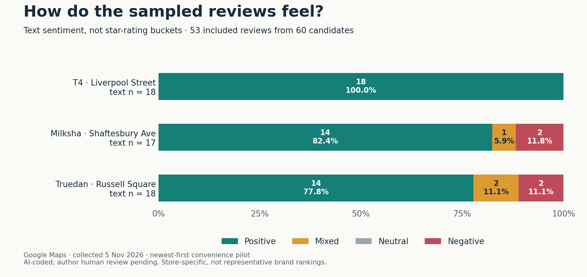
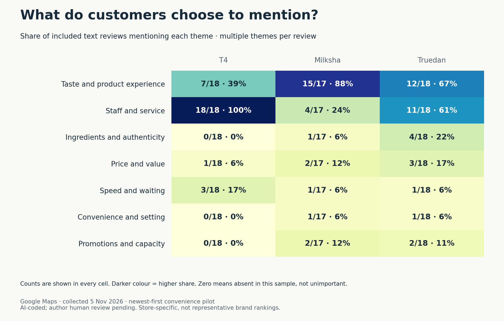
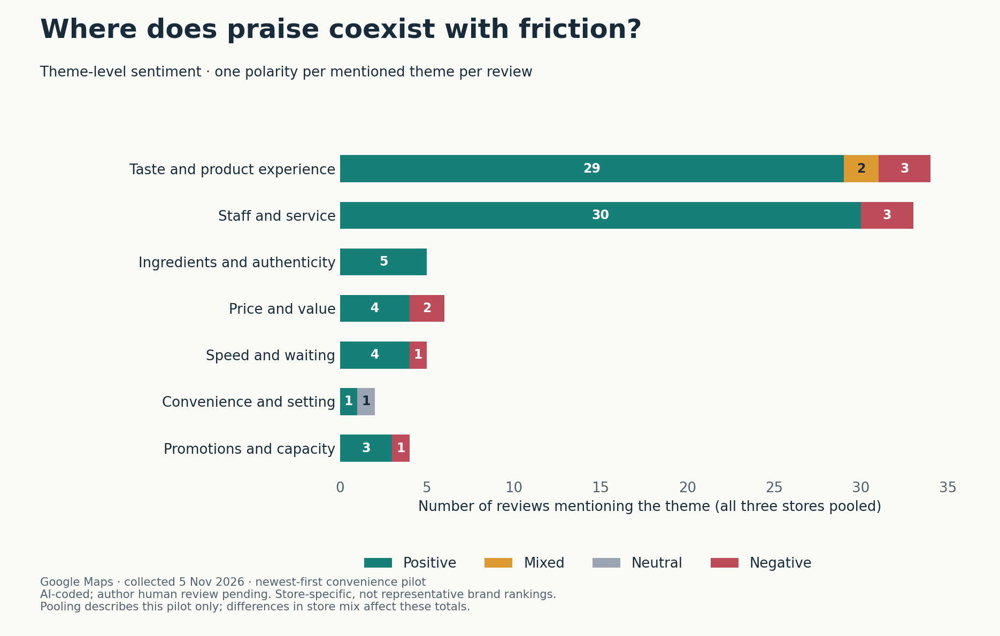

# Positioning a Taiwanese Bubble Tea Brand in Central London

*AI-assisted sentiment and theme analysis to explore customer perceptions and competitive positioning in Zone 1.*

**Ying-Hsuan Fang** · UCL Market Intelligence individual project · Portfolio extension: 5 November 2026

## The decision behind the research

For a prospective Taiwanese bubble tea venture, how should authenticity, product experience, service and convenience shape its positioning in central London?

The original project proposed an authenticity-led venture, then questioned whether an efficiency-first model would perform better. This extension tests that story against a small, traceable set of publicly displayed customer reviews. **The pilot suggests preserving product appeal while testing service improvements; it does not establish that speed beats authenticity.**

## At a glance

| | T4 · Liverpool Street | Milksha · Shaftesbury Ave | Truedan · Russell Square |
|---|---:|---:|---:|
| Newest-first candidate records | 20 | 20 | 20 |
| Included customer-text reviews | 18 | 17 | 18 |
| Exclusions | 2 without text | 2 without text; 1 historical experience | 2 without text |
| Positive / mixed / neutral / negative | 18 / 0 / 0 / 0 | 14 / 1 / 0 / 2 | 14 / 2 / 0 / 2 |

**Status:** exploratory AI-coded pilot; author human review pending. These are selected reviews at three stores, not representative brand satisfaction scores. No data were invented to fill sentiment categories.

## 1 · Sentiment: preserve mixed experiences

The sample is mostly positive. However, four- and five-star reviews can still contain friction: the coding retains mixed experiences rather than converting stars into sentiment. T4's uniformly positive small sample should not be read as evidence that it has no dissatisfied customers.

## 2 · Themes: the positioning story is more nuanced

- **T4:** staff/service appears in 18 of 18 included reviews; explicit speed/efficiency appears in 3. This sample supports a service-led interpretation more strongly than a speed-only story.
- **Milksha:** product experience appears in 15 of 17 reviews. Two negative records also raise complaint-handling issues; a four-star review is coded mixed for qualified product praise.
- **Truedan:** explicit Taiwanese authenticity appears in 4 of 18 records. Waiting is criticised in one record, while another praises staff but criticises promotion-related capacity pressure. The latter is not counted as a waiting mention without explicit text.

## 3 · Implication: test the friction, protect the appeal

Treat authenticity and reliable service as potentially complementary. Test preparation and order-handling improvements while tracking product quality, workload and contribution per cup. Do not infer sales, profitability or customer identity from review counts.

A promotion-related capacity comment also challenges the original decision to exclude delivery/digital effects entirely. It is a signal to investigate, not proof that a specific channel caused poor performance.

## Why these cases?

The research initially considered a wider competitive set, then focused on Taiwanese-origin brands as contrasting positioning cases. The founder's selection rationale distinguished domestic Taiwanese brand identity from international franchise expansion. Current franchise counts and Taiwan store footprints have not been independently established and are not used to explain the results.

| Case | Address confirmed on Google Maps | Scope |
|---|---|---|
| T4 Liverpool Street | 8 Brushfield Street, London E1 6AN | Near Liverpool Street / Spitalfields; not inside the station |
| Milksha | 65 Shaftesbury Avenue, London W1D 6LH | Chinatown / Soho |
| Truedan Russell Square | Unit K1 Brunswick Square, London WC1N 1AW | Brunswick Centre |

These locations span central London's Zone 1 context, not one fixed street or a controlled within-neighbourhood comparison. One store per brand confounds brand with location. The earlier Hampstead summary is not used in this new sample.

## Method in brief

On 5 November 2026, Google Maps was set to **Newest**, without keyword or rating filters. The first 20 displayed candidate records per store were inspected. Six rating-only entries and one record explicitly describing a 2021 experience were excluded; owner replies were not analysed. The resulting n is 53.

Displayed dates are relative and may reflect edits, not visit dates. Included display ages range from hours to about a month, with different spans per store. Nine included records used Google-displayed Chinese-to-English translations. This is a recent-activity convenience pilot, not a fixed-window random sample.

Codex assigned semantic sentiment and multiple themes from visible customer text, expanding available long-review controls. A second AI review checked ambiguous cases and exclusions. **This is not human validation.** The author-check sheet remains blank; no accuracy metric is claimed.

## Evidence and reproducibility

- [Public coding table: all 60 candidates, source IDs, exclusions and paraphrases](review_coding_public.csv)
- [Sampling and collection](collection.md)
- [Coding definitions](codebook.md)
- [AI workflow and decision rules](ai_workflow.md)
- [Evidence audit and sensitive classifications](evidence_audit.md)
- [Results, counts and sensitivity note](findings.md)
- [Source register](source_register.md)
- [Proposed 90-day test](90_day_test_plan.md)
- [Author validation worksheet](author_review.csv)
- [Chart-building script](build_charts.py) · [Computed totals](summary_counts.json)

The Python script only aggregates the published labels and renders charts; it does not run a sentiment model. It was generated with Codex assistance. Run `python3 build_charts.py` with matplotlib and numpy installed.

## Contribution and limits

The original individual project supplied the venture framing, competitor selection and strategic argument. The portfolio extension uses Codex for public-review collection, provisional semantic coding, evidence checks, chart code and documentation. The original brief declared Gemini analysis/writing support; its exact historical model and prompts remain unverified. NotebookLM retains research materials but is not an independent source of corroboration.

Self-selection, repeated staff mentions, promotions, translations, review edits and store mix can affect these results. Review statements are unverified experiences, not established operational facts. Zero mentions do not prove absence. The new sample is separate from the February 2026 assignment evidence. No sales uplift, profitability, causal effect or completed operational pilot is claimed.

Independent academic portfolio project; no affiliation with the brands. Reviewer names, profile images and full review text are not republished. The revision prioritises traceable evidence over reproducing the original conclusion.
