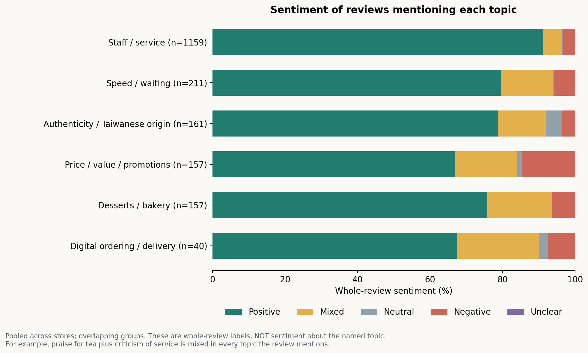

# Full-snapshot findings

## Coverage and sentiment

All 2,941 unique Google review/rating records were captured. Of these, 2,375 contain text and 566 are rating-only. Every text was read for AI semantic sentiment; every record contributes to the rating distribution.

| Store | Positive | Mixed | Neutral | Negative | Unclear | Text denominator |
|---|---:|---:|---:|---:|---:|---:|
| T4 | 1,249 | 35 | 8 | 30 | 1 | 1,323 |
| Milksha | 310 | 59 | 5 | 44 | 0 | 418 |
| Truedan | 571 | 28 | 13 | 20 | 2 | 634 |
| Total | 2,130 | 122 | 26 | 94 | 3 | 2,375 |

Mixed or negative text is 65/1,323 (4.9%) at T4, 103/418 (24.6%) at Milksha and 48/634 (7.6%) at Truedan. These are labelled review shares, not dissatisfaction rates among all customers. Five-star texts assigned a different label number 20, 27 and 29 respectively. Stars would conceal some mixed experiences.

## Topic differences

| Dictionary topic | T4 n=1,323 | Milksha n=418 | Truedan n=634 |
|---|---:|---:|---:|
| Product/drink vocabulary | 823 (62.2%) | 339 (81.1%) | 489 (77.1%) |
| Staff/service | 842 (63.6%) | 120 (28.7%) | 197 (31.1%) |
| Speed/waiting | 128 (9.7%) | 39 (9.3%) | 44 (6.9%) |
| Authenticity/origin | 17 (1.3%) | 51 (12.2%) | 93 (14.7%) |
| Price/value/promotions | 45 (3.4%) | 56 (13.4%) | 56 (8.8%) |
| Customisation | 32 (2.4%) | 26 (6.2%) | 36 (5.7%) |
| Setting/location | 59 (4.5%) | 33 (7.9%) | 36 (5.7%) |
| Desserts/bakery | 1 (0.1%) | 142 (34.0%) | 14 (2.2%) |
| Digital/delivery | 16 (1.2%) | 11 (2.6%) | 13 (2.1%) |
| Repeat/loyalty language | 158 (11.9%) | 56 (13.4%) | 88 (13.9%) |

Topic shares are overlapping dictionary hits. They are not semantic aspect scores, independent customer priorities or a measure of commercial performance. Different product ranges and review lengths create different opportunities to mention a topic.

This supplemental chart pools stores and applies the **whole-review** sentiment to reviews mentioning a topic. It must not be read as sentiment specifically about that topic. A mixed review praising tea and criticising service is mixed in both groups.

## Broad recency sensitivity

| Text subset | T4 positive / n | Milksha positive / n | Truedan positive / n |
|---|---:|---:|---:|
| All displayed history | 1,249 / 1,323 (94.4%) | 310 / 418 (74.2%) | 571 / 634 (90.1%) |
| Displayed age under one year | 147 / 158 (93.0%) | 127 / 160 (79.4%) | 56 / 65 (86.2%) |

The broadly recent subset reduces the observed gap between Milksha and Truedan. It does not establish improvement or decline: date labels are rounded, edited dates exist, sample sizes differ and customer mix may change. All-history results should not be presented as current service performance.

## Observations → hypotheses → decisions

| Observed in the corpus | Plausible hypothesis, not proven | Decision implication |
|---|---|---|
| Staff/service vocabulary is frequent at T4 | Interpersonal service may be part of its positioning | Preserve staff support and hospitality when changing workflow |
| Authenticity/origin vocabulary appears more often at Milksha and Truedan | Taiwanese familiarity may contribute to differentiation | Test product-quality retention and willingness to pay directly |
| Milksha has 142 dessert/bakery mentions | Its experience mix differs from a drink-focused comparison | Separate drinks and desserts in operational/product testing |
| Some reviews praise products but criticise waits or recovery | Execution friction may weaken an otherwise appealing offer | Pilot order handling and queue management before removing craft products |
| Delivery/promotion-pressure examples appear | Channel load may affect in-store service | Include channel and staffing data in the test |

## What remains unproven

The study cannot establish that commuters dominate these stores, that speed matters more than authenticity, that T4's review volume means greater sales, or that standardisation improves margins. Queue mentions are additional coded detail within the same source, **not independent external triangulation**. The next evidence should be matched peak-hour observations and actual operating economics. The proposed 90-day plan describes this next step; no operating trial has been run.
